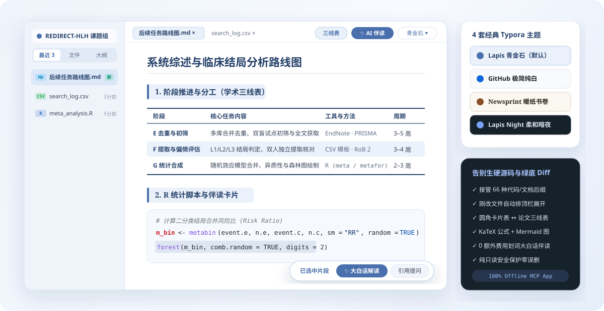

<p align="center">
  
</p>

<h1 align="center">Antigravity Better Sidebar · Typora 沉浸侧栏工作台</h1>

<p align="center">
  <b>把 Google Antigravity 右侧栏与文件预览彻底改造成 Typora Lapis 级清透纸面（青金石学术排版 · 论文三线表一键切换 · 最近改动自动展开 · 0 额外费用划词大白话伴读）</b>
</p>

<p align="center">
  
  
  
  
</p>

<p align="center">
  
</p>

---

## ✨ 为什么做这个插件？

在 **Google Antigravity** 里做科研项目或 Vibe Coding 时，经常遇到三大痛点：
1. **点开 `N files changed` 全是生硬绿底 Diff 源码**：AI 刚写好的漂亮 Markdown 路线图或宽表格，点开却是一堆 `| --- |` 绿底代码行，根本没法舒服阅读；
2. **原生单文件预览器过于简陋**：缺少像 **Typora** 那样呼吸感十足的留白纸面、胶囊章节标题、论文三线表以及目录大纲平滑跳转；
3. **打开陌生代码看不懂又怕误改**：遇到 R / Python / TypeScript 脚本想快速搞懂某几行在干什么，还得手动复制粘贴回对话框解释。

**`agy-better-sidebar`** 基于 Antigravity 官方 **MCP App (`aux_pane` + `global` + `file` 三入口)** 标准打造，**零侵入、无需篡改客户端、100% 离线单文件运行**，让你在对话右侧直接拥有一间 **Typora 青金石级阅读书房**！

---

## 🧩 五大核心亮点

### 1. 真·Typora 极简无框骨架（Chromeless Paper UI）
* **消隐工业框线**：砍掉传统 IDE 层层堆叠的工具栏与底部状态栏，将 **92% 以上画面**留给通透的 `#write` 阅读纸面。
* **正统「最近 | 文件 | 大纲」三合一抽屉**：左侧采用 Typora 经典极简抽屉，支持一键收起进入 100% 纯享沉浸阅读；在排版预览下点击「大纲」可直接**平滑滚动到对应章节标题**并柔和闪烁提示，按 `Ctrl+/` 随时切换「看排版 / 看源码」。

### 2. 默认搭载 `Lapis 青金石` 主题 + 4 套经典预设一键切换
* 深度复刻 GitHub 高赞开源主题 **[`typora-theme-lapis`](https://github.com/YiNNx/typora-theme-lapis)** 排版精髓：衬线中文标题配清晰无衬线正文、标志性**浅蓝胶囊底纹二级标题（`H2`）**、柔和引用块与顶部 YAML 元数据属性条。
* 右上角一键切换 4 套经典主题与字号（`12px–22px`）：
  * **Lapis 青金石（默认）** — 清透湖蓝 · 科研与长文首选
  * **GitHub 极简白** — 纯白克制 · 现代技术文档风
  * **Newsprint 暖纸书卷** — 微暖米纸 · 衬线期刊护眼感
  * **Lapis Night 柔和暗夜** — 静谧灰蓝 · 夜间柔和不刺眼

### 3. 科研宽表格专项美化（「圆角卡片表 ↔ 学术三线表」一键切换）
* 专为 6～14 列科研路线图、PRISMA 检索日志表与医学数据集设计**防挤碎平滑横滑容器**，彻底杜绝多列中文被挤压成竖条碎字。
* Markdown 表格与 **CSV / TSV 数据表**共享顶栏一键切换：**「Lapis 圆角斑马卡片表」** ↔ 论文投稿标准的 **「学术三线表」**（CSV 同时支持关键词实时筛选、点击表头排序与点击单元格复制）。

### 4. 告别绿底 Diff：最近改动自动置顶 + 打开即看
* **「最近」面板兼容有 Git 与无 Git 文件夹**：自动融合 Git 未提交状态（完美支持中文文件名与空格）及文件最新修改时间排序，标注 `新` / `改` 与相对时间。
* **零多余点击**：打开工作台时自动把**最新改动的第 1 个文件**以漂亮排版展开，并将近期改动的其余几个文件自动并排挂上**顶部轻量标签栏**；内置 `rules/AGENTS.md` 规范，让 AI 每次改完文件自动附上直达美化阅读链接。

### 5. 全品类可视化 + 0 额外费用划词 AI 伴读（纯只读安全）
* **自动接管 66 种常见后缀**：涵盖 Python / R / Rmd / Jupyter `.ipynb` / CSV / TSV / JSON / YAML / TOML / Markdown / Mermaid / KaTeX 数学公式 / HTML / SVG / TS / JS / Vue / SQL / Shell 等，代码文件统一装入圆角清透代码纸卡。
* **划词即问（复用现有 Antigravity 额度，无需额外 API Key）**：在文档或代码中鼠标划选任意片段，右下角自动浮出 **「✨ 大白话解读 | 引用提问」** 气泡；右上角「AI 伴读」菜单还支持一键生成逻辑流程图、逐段导读，以及开启**「发往后台新对话（不打扰当前主任务）」**。
* **纯只读安全锁**：彻底杜绝阅读时手滑误删代码，所有修改安心交给主对话 Agent 执行。

---

## 🚀 零编译一键安装（Windows / macOS / Linux）

仓库与 Release 已内置完整预编译离线单文件产物（由 Antigravity 内置 Node 运行时直接驱动，**无需等待 `npm install` 编译**）。

### 安装步骤

1. 获取插件包（任选一种方式）：
   * **方式 A（推荐，免装 Git）**：前往右侧 **[Releases 页面](https://github.com/pvijaypal2000-tech/agy-better-sidebar/releases/latest)** 下载 `agy-better-sidebar-v2.0.0.zip` 并解压。
   * **方式 B（Git 克隆）**：
     ```bash
     git clone https://github.com/pvijaypal2000-tech/agy-better-sidebar.git
     cd agy-better-sidebar
     ```
2. 运行一键安装脚本（1 秒自动部署到 `~/.gemini/config/plugins/agy-better-sidebar`）：
   * **Windows**：直接双击 **`install.bat`**
   * **macOS / Linux**：
     ```bash
     bash install.sh
     ```
3. **重启一次 Google Antigravity 桌面端**（或在 Customizations 插件页刷新 MCP 服务）：
   * **打开侧栏工作台**：点击对话右上角 **Overview > Plugins > Better Sidebar**（或侧栏 `+` 号菜单 / 左侧栏 `Plugins` 全屏页）；
   * **单文件自动接管**：直接点击对话里的 `[文件名](file:///...)` 链接或按 `Ctrl+P` 打开文件，自动呈现 Typora Lapis 纸面！（仓库根目录附带 [`DEMO_TYPORA_LAPIS.md`](DEMO_TYPORA_LAPIS.md) 可直接点开试玩）。

---

## 🔗 反重力效率三件套（姊妹插件推荐）

搭配同系列纯本地零侵入插件一起使用，打造高颜值、有记忆、会陪伴的 Antigravity 工作站：

* 🌌 **[agy-local-memory](https://github.com/pvijaypal2000-tech/agy-local-memory)** — 纯本地零依赖跨会话认知图谱记忆引擎 + 交互式银河星云可视化（MCP App 侧栏直开）
* 🐾 **[agy-gemini-pet](https://github.com/pvijaypal2000-tech/agy-gemini-pet)** — 随 Antigravity 自动联动的透明无边框悬浮监测桌宠（5 套多风格皮肤 · 0 Token 账单监测 · 参数化音效台）

---

## 🛠️ 二次开发与自定义构建

如果你想自行修改主题 CSS 或扩展预览器（需 Node.js 20+）：

```bash
npm install
npm run typecheck      # TypeScript 严格类型检查
npm run build          # 打包 workbench.html / viewer.html 单文件与 server.mjs
npm run deploy         # 同步部署至本机 ~/.gemini/config/plugins/agy-better-sidebar
node scripts/verify-mcp.mjs  # 运行 MCP 协议、离线 CSP 与路径越权拦截端到端自检
```

## 📂 仓库结构

```text
agy-better-sidebar/
├── install.bat                  # Windows 零编译一键安装脚本
├── install.sh                   # macOS / Linux 一键安装脚本
├── DEMO_TYPORA_LAPIS.md         # 含宽表、KaTeX 公式、Mermaid 与 R 代码的排版演示稿
├── LICENSE                      # MIT 开源协议与致谢声明
├── plugin/                      # 可直接分发的自包含 Antigravity 插件包
│   ├── plugin.json              # 插件元信息与推荐提示词
│   ├── mcp_config.json          # Stdio MCP 服务声明
│   ├── assets/logo.svg          # Lapis 青金石主题插件图标
│   ├── rules/AGENTS.md          # 自动附带直达美化阅读链接的协作规则
│   ├── skills/better-sidebar/   # 引导 Agent 自动对齐当前工作区的技能说明
│   └── dist/                    # 预编译离线单文件前端与 MCP 服务端产物
├── server/
│   └── index.ts                 # 本地只读安全 MCP Server（目录浏览、近期改动检测、状态持久化）
└── src/
    ├── WorkbenchApp.tsx         # 右侧栏 / 全屏 Typora 工作台入口
    ├── ViewerApp.tsx            # 66 种后缀原生单文件接管入口
    ├── styles/theme.css         # Lapis / GitHub / Newsprint / Night 主题与三线表排版系统
    ├── shared/                  # 多语言静态大纲解析器、MCP 伴读桥接与类型定义
    └── components/              # Typora 三合一侧栏、无框纸面画布、CodeMirror 卡片与富媒体预览器
```

---

## 🙏 致谢与开源协议

本项目采用 **[MIT License](LICENSE)** 开源。

* 默认 **Lapis 青金石** 主题配色、衬线标题层次与胶囊二级标题设计致敬开源 Typora 主题 **[`YiNNx/typora-theme-lapis`](https://github.com/YiNNx/typora-theme-lapis)**（MIT）。
* 侧栏工作台与文档增强体验灵感参考 `omdsh-dev/DSH-better-sidebar`、`obgnail/typora_plugin` 与 `MadMaxChow/VLOOK`。
